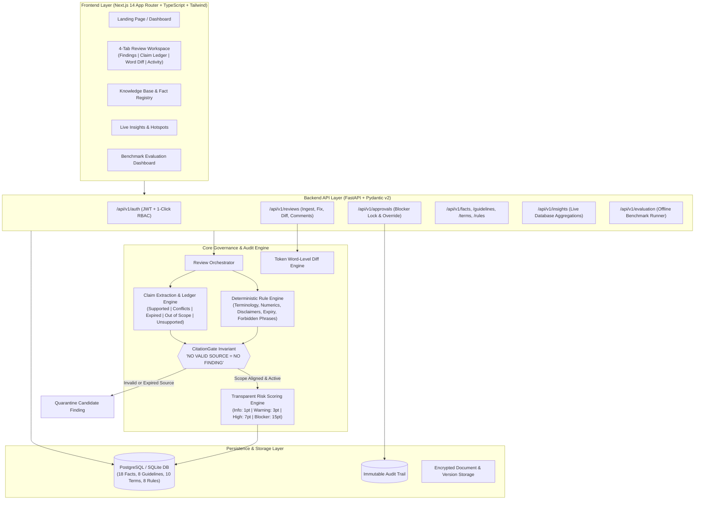

# BrandProof — Pre-Publication Brand Governance Platform

> **"Every claim, traced to its source."**
> *Review marketing content against approved facts and brand guidelines before it ships.*
> **"AI proposes. Evidence decides. People approve. NO VALID SOURCE = NO FINDING."**
> *AI must never be the final approver.*

---

BrandProof is a pre-publication brand-governance and claim-substantiation SaaS platform built for high-stakes enterprise organizations. It enables marketing, communications, legal, and compliance teams to ingest content drafts and systematically evaluate them against an authoritative, approved source of truth consisting of:

- **Approved Facts**: Canonical values, benchmark metrics, certifications, and SLAs with automated expiration lifecycles.
- **Brand Guidelines**: Voice principles with explicit DO and DON'T exemplars.
- **Approved Terminology**: Strict dictionary of approved trademarks and disallowed legacy/competitor variants.
- **Governance Rules**: Mandatory footnote disclaimers, prohibited absolute marketing terms, and custom regex policies.
- **Immutable Audit Trail**: SOC-2 / ISO compliant event log capturing all draft revisions, human approvals, and Blocker overrides.

---

## 🏛️ System Architecture



---

## 👥 The 5 Enterprise Personas (Credentials)

BrandProof models authentic enterprise governance hierarchies with 5 distinct roles:

| Role | Demo User | Title & Responsibilities | Blocker Override Authority |
| :--- | :--- | :--- | :---: |
| **Reviewer** | `reviewer@northstarcloud.com` | **Elena Rostova**, Senior Legal & Compliance Counsel. Audits pending drafts, accepts 1-click proposed fixes, and requests changes. | ❌ Locked by Blockers |
| **Brand Manager** | `brandmanager@northstarcloud.com` | **Marcus Vance**, Global Brand Director. Authors voice guidelines, maintains terminology dictionary, and possesses **executive authority to override Blockers**. | ✅ Authorized Override |
| **Creator** | `creator@northstarcloud.com` | **Sarah Chen**, Lead Product Marketing Manager. Ingests campaign copy and documents, configures intent cards, and reviews remediation feedback. | ❌ Read-Only Decisions |
| **Fact Owner** | `factowner@northstarcloud.com` | **David Kim**, Chief Systems Architect. Manages canonical facts, validates regulatory citations, and monitors countdowns to expiration. | ❌ Fact Authority Only |
| **Admin** | `admin@northstarcloud.com` | **Alexandra Wright**, VP of Governance & Trust. Configures organizational rules, manages RBAC permissions, and runs benchmark evaluations. | ✅ Full System Authority |

> 🔒 **Demonstration Environment**: In local development or isolated demo environments, accounts can be seeded by setting `DEMO_USER_PASSWORD` (or letting the seed script generate an ephemeral password). In production environments, demo account creation and automated seeding are strictly disabled.
> ⚡ **Demo Navigation**: In demo mode (`NEXT_PUBLIC_ENABLE_DEMO_MODE=true`), clicking any persona on the login page (`/login`) pre-fills their email address.

---

## ⚡ 5-Minute Evaluation Walkthrough

Follow this step-by-step walkthrough to evaluate BrandProof's core features:

### 1. Launch & Explore the Landing Page (`/`)
- Navigate to `http://localhost:3000` (or your deployed frontend URL).
- Review the core mission: *"Every claim, traced to its source."* and the three pillars (*AI proposes. Evidence decides. People approve.*).
- Click **"Sign In"** to access the login portal.

### 2. Open the Seeded Demonstration Review (`/reviews`)
- From the Dashboard or Reviews list, click on **"Q2 Onboarding Acceleration Ad Copy"** (or Review #1).
- Note the top header:
  - **Status**: `Needs Review`
  - **Risk Score Pill**: `Risk Score: 41 • Critical Risk` (calculated transparently from 2 Blockers, 1 High, 1 Warning, 1 Info).
  - **Governed Target Scopes**: Product `Northstar Pro`, Region `India`, Channel `Advertisement`.
  - **Blocker Alert Banner**: Prominently warns that active blockers lock publication sign-off.

### 3. Inspect Tab 1: Findings & Accept 1-Click Fix
- Switch to the **Findings** tab.
- Observe finding #1: Disallowed term `"Northstar Premium"` flagged with suggestion to use approved `"Northstar Pro"`.
- Observe finding #2: Conflicting claim `"60%"` flagged against canonical fact `"25%"`.
- Observe finding #3: Expired ISO 27001 certificate flagged (expired 45 days ago).
- Observe that **every finding has an approved source citation badge** (strictly enforced by CitationGate).
- Click **"Accept Fix"** on the terminology finding.
- **Result**: Watch BrandProof automatically produce **Version 2**, re-audit the draft, and switch to the Changes / Diff tab!

### 4. Inspect Tab 2: Changes / Diff
- View the word-level remediation diff comparing `Version 1 → Version 2`.
- Notice the **green highlighted additions** (`+words added`), **red strikethrough deletions** (`-words removed`), and diff statistics.
- Verify the change rationale: *"Applied fix for: Use approved Northstar Pro"*.

### 5. Inspect Tab 3: Claim Ledger
- Click the **Claim Ledger** tab.
- Examine the 5-state claim verification ledger:
  - `SUPPORTED`: Claims matching active canonical facts within product/region/channel scope.
  - `CONFLICTS`: Numeric assertions contradicting registered fact values.
  - `EXPIRED`: Claims citing facts whose `expires_at` timestamp is in the past.
  - `UNSUPPORTED`: Superlative or ungrounded assertions lacking an approved source of truth.
- View confidence scores and audit reasoning for each statement.

### 6. Test Blocker Protection & Executive Override
- Notice that as **Reviewer (Elena)**, the **"Approve Publication"** button is **LOCKED** because open Blocker findings remain.
- Hover over the locked button to see the compliance policy explanation.
- Use the top navigation role switcher to switch to **Brand Manager (Marcus)**.
- Notice the prominent amber **"Override Blockers & Approve"** button appears.
- Click it, provide a mandatory compliance justification (minimum 10 characters, e.g. *"Legal exemption approved by General Counsel for India launch"*), and submit.
- Notice the review status changes to **Approved**, with `is_override = true` logged permanently to the audit trail.

### 7. Inspect Live Governance Insights (`/insights`)
- Click **Insights** in the top navigation.
- Inspect real-time metrics dynamically computed from the database:
  - Total Reviews, Open Blockers, Resolution Rate %, Average Risk Score.
  - Severity Breakdown and Risk Distribution charts.
  - Top Violated Governance Rules and Top Disallowed Terminology Hotspots.

### 8. Run Offline Evaluation Benchmarks (`/evaluation`)
- Click **Evaluation** in the sidebar.
- Click **"Run Benchmark Suite"** to execute offline tests against the ground-truth dataset (`benchmark_dataset.json`).
- View real-time KPI cards: **Precision (100%)**, **Recall (100%)**, **F1-Score (1.00)**, and **Accuracy (100%)**.
- Click **"Export CSV Report"** to download the evaluation results for grading.

### 9. Reset Demo Data (1-Click)
- Click **"Reset Demo Data"** in the top navigation bar at any point to restore the clean database state.

---

## 🛠️ Technology Stack

- **Frontend**: Next.js 14 (App Router), TypeScript, Tailwind CSS, Lucide Icons, Headless UI.
- **Backend**: FastAPI, Python 3.11+, Pydantic v2, SQLAlchemy 2.0, Alembic migrations.
- **Storage / Database**: PostgreSQL (with pgvector support) / SQLite compatible.
- **Governance Engines**: Deterministic Rule Engine, CitationGate validator, Word-level Diff Engine, Fallback LLM Provider (zero external API keys required), Pillow / Tesseract OCR service.

---

## 🚀 Running Locally

### 1. Backend Setup
```bash
cd backend

# Create & activate virtual environment (optional)
python -m venv .venv
# Windows:
.venv\Scripts\activate
# Linux/macOS:
source .venv/bin/activate

# Install dependencies
pip install -r requirements.txt Mako

# Run migrations to head
alembic upgrade head

# Seed initial Northstar Cloud enterprise dataset
python seed.py

# Launch FastAPI server on port 8000
uvicorn app.main:app --host 127.0.0.1 --port 8000 --reload
```
- API Base URL: `http://localhost:8000/api/v1`
- Swagger UI Documentation: `http://localhost:8000/docs`

### 2. Frontend Setup
```bash
cd frontend

# Install exact dependencies
npm ci

# Run lint and type checking
npm run lint

# Build & launch Next.js application on port 3000
npm run build
npm run start
# Or for live hot-reload development:
npm run dev
```
- Frontend UI: `http://localhost:3000`

---

## 🧪 Automated Test Suite

Run the full pytest suite (43 comprehensive passing tests covering security audit, tenant isolation, rule checkers, CitationGate quarantine, risk scoring, diff engine, blocker protection, and RBAC):

```bash
cd backend
pytest -v
```

Expected result:
```
43 passed (100% passing test coverage of master governance pipeline & security audit)
```

---

## 🚀 Production Deployment (GitHub + Render + Vercel)

BrandProof is production-ready for automated CI/CD deployment:

- **Source Code**: Private GitHub repository
- **Backend API & PostgreSQL**: [Render](https://render.com) using the included `render.yaml` Blueprint
- **Frontend App**: [Vercel](https://vercel.com) (Next.js 14 App Router)
- **Object Storage**: S3-compatible cloud storage (AWS S3, Cloudflare R2, MinIO, or Render persistent disk)

👉 **For complete step-by-step production deployment instructions, environment variable specifications, and troubleshooting, see [DEPLOYMENT.md](file:///X:/Hackathons/codenova/BrandProof/DEPLOYMENT.md).**

---

## 🔒 Security Hardening & Invariants

BrandProof implements rigorous enterprise-grade security controls:

1. **Organization Isolation & Anti-Takeover**:
   - New registrations strictly create unique organizations.
   - Public registration cannot claim, join, or become an administrator of an existing organization slug.
2. **Safe Production Fail-Safes**:
   - In production (`ENVIRONMENT=production`), the application strictly fails to start if `SECRET_KEY` is a default/insecure value or shorter than 32 characters, if SQLite is configured, or if demo reset is enabled.
3. **Cardinal Blocker Invariant**:
   - Reviews containing open Blocker findings cannot be approved through normal workflows or status update bypasses.
   - Blocker overrides require authorized Brand Manager / Admin credentials with a mandatory business justification (min 10 characters) and permanent audit trail logging.
4. **CitationGate Invariant: "NO VALID SOURCE = NO FINDING"**:
   - Unsubstantiated claims or expired facts cannot produce automated findings.
5. **Alembic Schema Authority**:
   - Production database initialization is strictly managed by `alembic upgrade head` before serving traffic, removing ad-hoc table creation.

---

## 📜 Core Governance Principles

1. **AI Proposes. Evidence Decides. People Approve.**
   - AI algorithms highlight candidate claims and draft suggestions; human beings make the final publication call.
2. **NO VALID SOURCE = NO FINDING.**
   - Every finding is strictly validated against an active, non-expired, in-scope canonical record in the database. Unverifiable assertions are quarantined.
3. **Blocker Protection Invariant.**
   - Content with unresolved Blocker findings cannot be approved through normal workflows. Overrides require Brand Manager or Admin credentials with mandatory documented rationale.
4. **Permanent Audit Trail.**
   - Every version increment, rule check, dismissal, comment, and approval is immutably timestamped and recorded.
